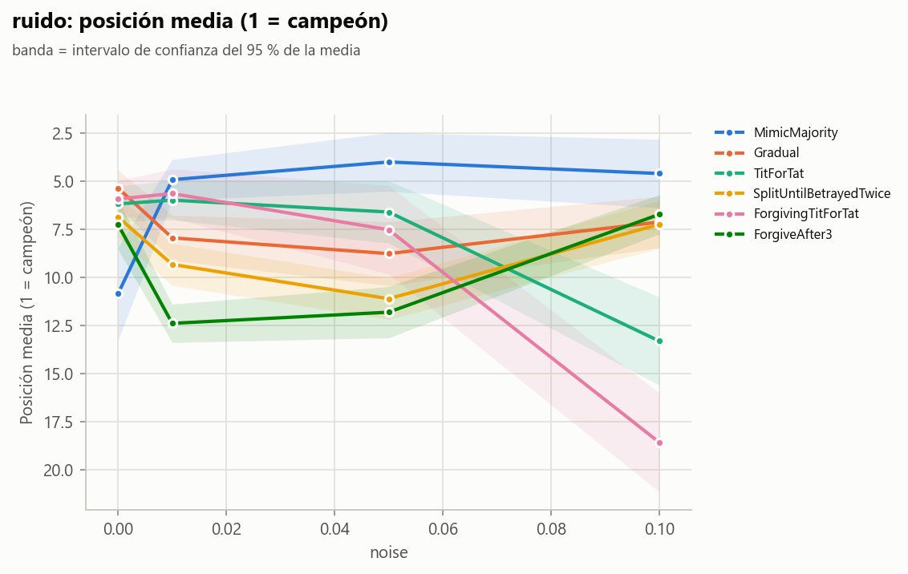

# Split/Steal: un laboratorio de estrategias de cooperación

Simulador en Python del juego **Split/Steal iterado** (una variante del *dilema del
prisionero*). **36 estrategias** (escritas a mano y clásicas de la literatura) compiten en
torneos configurables: ligas con ascensos y descensos o todos contra todos, con errores
(ruido), otros pagos, y repetidos con decenas de semillas para separar lo robusto de la suerte.

> ¿Qué comportamiento sale ganando cuando se juega muchas veces seguidas: cooperar,
> traicionar o algo intermedio? ¿Y cambia la respuesta si hay errores, si traicionar
> tienta más o si cambia el formato de la competición?


## El juego

En cada ronda dos jugadores eligen a la vez **SPLIT** (cooperar) o **STEAL** (traicionar):

|                 | Rival SPLIT | Rival STEAL |
|-----------------|:-----------:|:-----------:|
| **Yo SPLIT**    | 3 , 3 (R)   | 0 , 5 (S)   |
| **Yo STEAL**    | 5 , 0 (T)   | 1 , 1 (P)   |

En una sola ronda siempre conviene traicionar: ganas 5 en vez de 3 si el otro coopera, y
1 en vez de 0 si traiciona. Pero si los dos razonan así acaban en 1-1, peor que el 3-3 de
cooperar. Cuando se juegan **100 rondas seguidas contra el mismo rival**, cada jugador puede
castigar la traición del otro, y la cooperación puede salir rentable. Los pagos (R, S, T, P)
son configurables.

## Qué se puede simular

- **Estrategias**: 36 en el roster oficial, cada una con descripción y etiquetas (`amable`,
  `traicionera`, `vengativa`, `perdona`...). Se eligen por nombre, por *preset* o
  combinando: `"clasicas, -AlwaysSteal, +Extortioner, ForgivingTitForTat(p=0.2)"`.
- **Formatos**:
  - `leagues`: clasificatoria todos contra todos y luego ligas jerarquizadas (Liga 1 = la
    mejor) durante varias temporadas; los 2 primeros de cada liga suben y los 2 últimos bajan.
  - `round_robin`: una sola liga con todas, como en los torneos de Axelrod.
- **Reglas**: rondas por partido, matriz de pagos, **ruido** (probabilidad de que una jugada
  salga al revés: un error, un malentendido) y desempates (puntos → enfrentamiento directo →
  diferencia de puntos → sorteo con la semilla).
- **Repeticiones**: el mismo torneo con N semillas, **en paralelo** (50 torneos en ~10 s).
- **Experimentos**: un archivo `.toml` describe qué variar (`[sweep]`) o qué comparar
  (`[[variants]]`); el programa juega todas las variantes × semillas y deja una tabla lista
  para comparar.

## Resultados destacados

Cada experimento repite cada condición con **50 semillas** (`experiments/*.toml`; detalle y
gráficas en [`notebooks/02_experimentos.ipynb`](notebooks/02_experimentos.ipynb)).

**1. Ganar partidos no es ganar torneos.** Sin ruido, `AlwaysSteal` no pierde ningún
enfrentamiento directo (31 victorias, 4 empates, 0 derrotas) y gana el 85 % de sus partidos,
pero queda de media en el puesto 18 de 36. `TitForTat`, sin errores, no puede ganar ni un partido (como mucho
empata) y siempre está arriba. En un juego que no es de suma cero cuenta cuánto sumas, no a
cuántos ganas.

**2. Con errores gana quien juzga por la trayectoria.** Con un 5 % de ruido, `MimicMajority`
(juega lo que el rival ha hecho más veces) gana el 38 % de los torneos: un error aislado no
cambia la mayoría, así que lo ignora, pero castiga a quien traiciona de forma persistente.
`TitForTat`, que solo mira la última jugada, aguanta hasta el 5 % de ruido y se hunde al 10 %.
Con más errores la cooperación media baja del 64 % al 48 % y `AlwaysSteal` sube del puesto
18 al 11.



**3. Perdonar, pero poco.** Barriendo la probabilidad de perdón de `ForgivingTitForTat`, lo
mejor es perdonar un 10-20 % de las traiciones; a partir de 1/3 empeora claramente. El 1/3 de
la teoría (Nowak y Sigmund) es el perdón *máximo* que una población puede permitirse, no el
óptimo cuando hay traidores. Y cuanto más se perdona, mejor le va a `AlwaysSteal`.

**4. El formato decide el campeón.** En todos contra todos sin ruido, `Gradual` gana el 96 %
de los torneos. En ligas ninguna pasa del 14 % y 13 distintas ganan algún título: en la Liga 1 se juntan cooperadoras
que empatan en todo (incluido el enfrentamiento directo) y **el 94 % de los descensos de la
Liga 1 los decide el sorteo**. Las traicioneras hacen de "ascensor": suben explotando a las
ingenuas de las ligas bajas y bajan al chocar con las vengativas.

**5. No hay una estrategia mejor en abstracto.** Si robar da más puntos (T = 8 en vez de 5),
`TitForTat` pasa a ser la mejor de media y `MimicMajority` se hunde: cuanto más vale una
traición, más caro sale tardar en responderla. Lo que es una virtud con errores (tolerar) es
un defecto con mucha tentación.

## Instalación

Con [conda/miniforge](https://github.com/conda-forge/miniforge):

```bash
conda env create -f environment.yml   # crea el entorno "splitsteal" e instala el paquete
conda activate splitsteal
```

Con pip, en cualquier Python ≥ 3.11:

```bash
pip install -e ".[dev]"
```

## Uso rápido

```bash
split-steal catalog                                        # todas las estrategias
split-steal tournament --name demo                         # un torneo -> results/runs/demo/
split-steal tournament --seeds 50 --noise 0.05 --name s50  # el mismo con 50 semillas, en paralelo
split-steal experiment experiments/ruido.toml              # un experimento completo
split-steal compare results/experiments/ruido --top 15     # tabla estrategia × variante
split-steal plot results/experiments/ruido                 # gráficas en .../figs/
```

(`python -m split_steal ...` funciona igual.) La **[guía de usuario](docs/GUIA_USUARIO.md)**
explica todas las opciones: selección de estrategias, ajustes, archivos de experimento,
qué contiene cada archivo de resultados y cómo analizarlos.

El run canónico (un torneo de referencia: 36 estrategias, 6 ligas × 6, 20 temporadas, sin
ruido, semilla 42) está en `results/canonical/canonical/` y se explica paso a paso en
[`notebooks/01_torneo_canonico.ipynb`](notebooks/01_torneo_canonico.ipynb). Se regenera
idéntico byte a byte:

```bash
split-steal tournament --name canonical --out-dir results/canonical
split-steal plot results/canonical/canonical
git status   # sin cambios
```

## Estructura del código

```
src/split_steal/
  strategies.py   Strategy (clase abstracta) + estrategias, con parámetros y etiquetas
  register.py     catálogo, presets y selección de estrategias a partir de texto
  simulator.py    motor: pagos, play_match (con ruido), desempates, ligas, formatos
  analysis.py     tablas derivadas: estadísticas, clasificación final, resumen entre
                  semillas, matriz de enfrentamientos
  runner.py       TournamentConfig -> run_tournament -> save_run / load_run
  multiseed.py    el mismo torneo con N semillas, en paralelo (procesos)
  experiment.py   experimentos .toml: variantes, barridos, catálogo y comparación
  plots.py        gráficas (matplotlib)
  cli.py          comandos de terminal (Typer)
experiments/      experimentos de ejemplo (.toml)
results/          canonical/ (versionado), experiments/ (resúmenes versionados), runs/ (local)
notebooks/        presentación de resultados (se ejecutan a mano)
tests/            pytest: reglas, estrategias, ligas, desempates, paralelo, experimentos
```

Flujo de datos:

```
experiment.toml ─► variantes (TournamentConfig) × semillas ─► run_many (procesos en paralelo)
                                                                 │ run_tournament(config)
                                                                 │   register.build_roster ─► estrategias nuevas
                                                                 │   League_Tournament | RoundRobinTournament
                                                                 │     └─ play_match ─► MatchResult (hechos del partido)
                                                                 ▼
                         matches / standings  ─► analysis ─► strategy_stats, final_ranking, summary
                                                                 ▼
                 results/experiments/<nombre>/ (summary.csv, variants/...) + results/index.csv
                                                                 ▼
                                               compare · plot · notebooks
```

## Añadir una estrategia

1. En `strategies.py`, hereda de `Strategy` e implementa `act`:

   ```python
   class MiEstrategia(Strategy):
       """Coopera salvo si el rival ha robado más de una fracción `umbral` de las veces."""
       tags = frozenset({"amable", "vengativa", "perdona"})

       def __init__(self, umbral: float = 0.5):
           super().__init__()
           self.umbral = float(umbral)       # cada parámetro, en un atributo con su nombre

       def act(self, h_self, h_opp, rng):
           if h_opp and h_opp.count(STEAL) > self.umbral * len(h_opp):
               return STEAL
           return SPLIT
   ```

   - `h_self` / `h_opp`: jugadas anteriores (`SPLIT = 0`, `STEAL = 1`) en este partido.
   - Para el azar usa **siempre** `rng` (p. ej. `rng.random()`), nunca `random`: así el
     torneo es reproducible.
   - Si guardas estado en atributos, bórralo en `reset()`, que se llama antes de cada partido.
   - El primer párrafo del docstring es su descripción y `tags` sus etiquetas (los tests
     comprueban que las `amable` nunca roban primero y las `traicionera` sí).
2. Ya está en el catálogo: úsala con `--roster "full, +MiEstrategia(umbral=0.3)"`. Para
   que sea oficial, añádela a `PRESETS["full"]` en `register.py` (y ajusta las ligas para que
   el número cuadre). `UserStrategy` es una plantilla lista para editar.

## Decisiones de diseño

- **Reproducibilidad con una sola semilla.** De la semilla maestra salen la de cada temporada,
  liga y partido; cada partido tiene su propio generador. El ruido usa un generador aparte, así
  que con y sin ruido las estrategias reciben los mismos números aleatorios. Misma
  configuración, mismos resultados byte a byte, también en paralelo (lo comprueban los tests).
- **Una única fuente de verdad.** El motor registra los hechos de cada partido (cooperaciones,
  traiciones, represalias, errores...); todas las estadísticas se calculan después a partir de
  ellos en `analysis.py`. Las estrategias solo deciden.
- **Capas con una sola responsabilidad.** El motor no escribe archivos; la persistencia está en
  `runner.py`/`multiseed.py`/`experiment.py` y la presentación en `plots.py`/`cli.py`.
- **Datos "tidy"**: una fila por observación y una columna `seed` en lugar de una carpeta por
  semilla. Un `groupby` basta para analizar.
- **Validación temprana.** Configuraciones imposibles o experimentos mal escritos fallan antes
  de jugar, con un mensaje que dice qué está mal.
- **Comprobar el comportamiento, no fiarse del nombre.** Un test compara cómo juega cada
  estrategia contra todas las demás: detectó dos que, pese a su descripción, jugaban
  exactamente como `TitForTat` (una se eliminó y otra, `WinStayLoseShift`, se corrigió).

## Limitaciones conocidas

- **Sin evolución.** Las estrategias no se reproducen según su éxito (dinámica evolutiva).
- **Duración conocida y fija.** Los partidos duran siempre lo mismo; no se modela una
  probabilidad de que el partido termine en cada ronda.
- **Solo ruido de ejecución.** No hay ruido de percepción (ver mal lo que hizo el rival).
- **`Extortioner` depende de los pagos 3/0/5/1**: con otros pagos pierde su propiedad
  matemática. No está en el roster oficial.

## Tests

```bash
pytest
```
