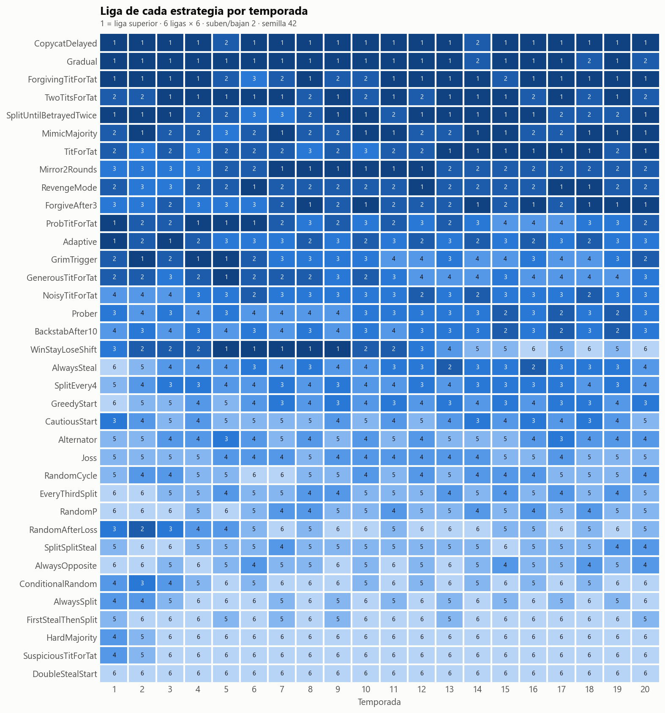
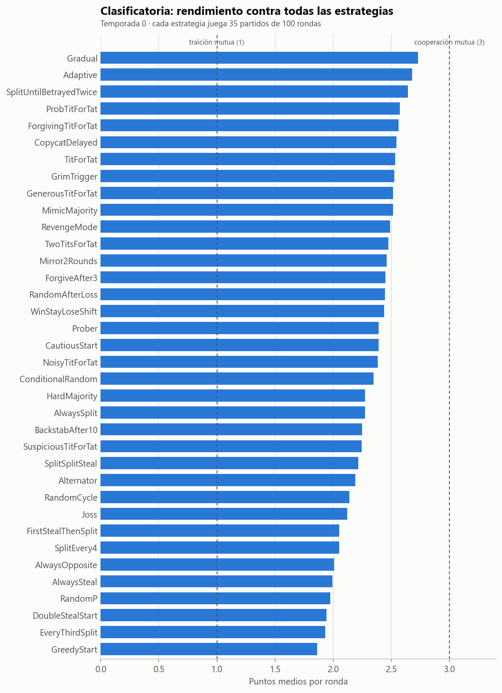
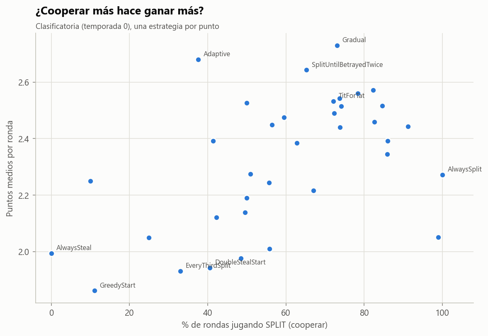

# Split/Steal: torneos de estrategias con ascensos y descensos

Simulador en Python del juego **Split/Steal iterado** (una variante del *dilema del
prisionero*). 30 estrategias escritas a mano compiten en un torneo con **ligas,
ascensos y descensos**, como una liga de fútbol. La pregunta de fondo:

> ¿Qué tipo de comportamiento sale ganando cuando se juega muchas veces seguidas:
> cooperar, traicionar o algo intermedio?



## El juego

En cada ronda dos jugadores eligen a la vez **SPLIT** (cooperar) o **STEAL** (traicionar):

|                 | Rival SPLIT | Rival STEAL |
|-----------------|:-----------:|:-----------:|
| **Yo SPLIT**    | 3 , 3       | 0 , 5       |
| **Yo STEAL**    | 5 , 0       | 1 , 1       |

En una sola ronda siempre conviene traicionar: ganas 5 en vez de 3 si el otro coopera,
y 1 en vez de 0 si traiciona. Pero si los dos razonan así acaban en 1-1, peor que el 3-3
de cooperar. Cuando se juegan **100 rondas seguidas contra el mismo rival**, cada
jugador puede castigar la traición del otro, y la cooperación puede salir rentable.

## Cómo funciona el torneo

1. **Partido**: dos estrategias juegan 100 rondas. Cada una solo ve lo que ha pasado
   antes en ese partido.
2. **Liga**: todos contra todos a una vuelta. Los puntos de liga son la **suma de
   puntos** de todos los partidos; no cuentan las victorias.
3. **Temporada 0 (clasificatoria)**: una única liga con las 30 estrategias. Su
   clasificación las reparte en 5 ligas de 6: las 6 mejores van a la Liga 1, las
   siguientes a la Liga 2, etc.
4. **Temporadas 1-20**: se juegan las 5 ligas. Al final de cada temporada, a la vez,
   los **2 primeros** de cada liga suben y los **2 últimos** bajan.

La diferencia con un torneo clásico (tipo Axelrod) es que, tras la clasificatoria, cada
estrategia solo juega contra rivales **de su nivel**. Una estrategia que vive de
explotar a las ingenuas puede funcionar en ligas bajas y hundirse al subir.

## Resultados del run canónico

Configuración: 30 estrategias · 5 ligas × 6 · 100 rondas por partido · 20 temporadas ·
suben/bajan 2 · semilla 42 (`results/canonical/canonical/`).

| Clasificatoria | Cooperación vs. puntos |
|---|---|
|  |  |

Observaciones:

- **Ganan las cooperadoras que castigan.** `GrimTrigger`, `SplitUntilBetrayedTwice`,
  `ForgiveAfter3` y la familia *Tit-for-Tat* encabezan la clasificatoria: cooperan
  mucho, pero responden a la traición.
- **Ni cooperar siempre ni traicionar siempre.** `AlwaysSplit` queda a media tabla
  porque la explotan, y `AlwaysSteal`, abajo: nunca pierde un partido, pero casi
  siempre acaba en el 1-1.
- **Empezar traicionando sale caro.** `DoubleStealStart`, `GreedyStart` y
  `FirstStealThenSplit` provocan represalias de las que no se recuperan.
- **En la Liga 1 todas empatan.** Cuando las 6 cooperan siempre, todas suman 1500
  puntos. El desempate (alfabético, ver limitaciones) decide quién baja. Por eso algunas
  estrategias oscilan cada temporada entre Liga 1 y Liga 2 (`GrimTrigger`, `TitForTat`,
  `MimicMajority`).

## Instalación

Con [conda/miniforge](https://github.com/conda-forge/miniforge):

```bash
conda env create -f environment.yml   # crea el entorno "splitsteal" e instala el paquete
conda activate splitsteal
```

Con pip, en cualquier Python ≥ 3.11:

```bash
pip install -e ".[dev]"
```

## Uso

```bash
split-steal list                                   # estrategias del roster oficial
split-steal tournament --seed 42 --name mi_run     # juega y guarda en results/runs/mi_run/
split-steal tournament --k 1 --rounds 200 -v       # otra configuración, mostrando ascensos
split-steal stats results/runs/mi_run              # tabla resumen por estrategia
split-steal plot  results/runs/mi_run              # gráficas en results/runs/mi_run/figs/
split-steal --help                                 # todas las opciones
```

(`python -m split_steal ...` funciona igual.)

Para regenerar el run canónico, con los mismos datos byte a byte:

```bash
split-steal tournament --name canonical --out-dir results/canonical
split-steal plot results/canonical/canonical
git status   # sin cambios
```

Cada run guarda:

| Archivo | Contenido |
|---|---|
| `config.json` | parámetros, semilla y lista de estrategias |
| `matches.csv` | un partido por fila: `season, league, A, B, pa, pb, seed` |
| `standings.csv` | clasificación: `season, league, position, name, points` |
| `strategy_stats.csv` | por estrategia y liga: rondas jugadas, nº de SPLIT/STEAL y puntos con cada uno |

Los notebooks de `notebooks/` analizan el run canónico: `01_quick_eda` compara
estrategias y `02_league_dynamics` estudia los ascensos y descensos.

## Estructura del código

```
src/split_steal/
  strategies.py   Strategy (clase abstracta) + las 30 estrategias
  register.py     rosters: qué estrategias participan ({nombre: instancia})
  simulator.py    motor: matriz de pagos, play_match, League, League_Tournament
  runner.py       TournamentConfig -> run_tournament -> save_run / load_run
  plots.py        gráficas (matplotlib)
  cli.py          comandos de terminal (Typer)
tests/            pytest: reglas, ligas, reproducibilidad
```

Flujo de datos:

```
TournamentConfig ─► register.ROSTERS[roster]() ─► League_Tournament.run(seed)
                                                     │  temporada 0: League con todas
                                                     │  temporadas 1..N: League por liga + ascensos/descensos
                                                     ▼
                               matches / standings / strategy_stats (DataFrames)
                                                     ▼
                         save_run ─► results/runs/<nombre>/  ─► stats · plot · notebooks
```

## Añadir una estrategia

1. En `strategies.py`, hereda de `Strategy` e implementa `act`:

   ```python
   class MiEstrategia(Strategy):
       """Coopera salvo si el rival ha robado más de la mitad de las veces."""
       def __init__(self):
           super().__init__("MiEstrategia")

       def act(self, h_self, h_opp, rng):
           if h_opp and h_opp.count(STEAL) > len(h_opp) / 2:
               return STEAL
           return SPLIT
   ```

   - `h_self` / `h_opp`: jugadas anteriores (`SPLIT = 0`, `STEAL = 1`) en este partido.
   - Para el azar usa **siempre** `rng` (p. ej. `rng.random()`), nunca `random`.
     Así el torneo es reproducible.
   - Si guardas estado en atributos, bórralo en `reset()`, que se llama antes de cada
     partido.
2. Añádela a una lista de `register.py`. Si cambia el número de estrategias, ajusta
   `--n-leagues` y `--n-per-league` para que el producto coincida.

`UserStrategy` es una plantilla lista para editar. Está en el roster de prueba:
`split-steal tournament --roster prueba --n-leagues 5 --n-per-league 5`.

## Decisiones de diseño

- **Reproducibilidad con una sola semilla.** El torneo deriva de la semilla maestra
  la de cada temporada, la de cada liga y la de cada partido. Cada partido tiene su
  propio generador aleatorio, que reciben las estrategias. Misma configuración, mismos
  resultados; lo comprueban los tests.
- **Estrategias como objetos con una sola decisión** (`act`). Así es fácil añadirlas
  y testearlas aisladas. `reset()` garantiza que un partido no dependa de los anteriores.
- **Motor sin efectos secundarios.** `simulator.py` no escribe archivos ni imprime
  nada. La persistencia está en `runner.py` y la presentación en `plots.py` y `cli.py`.
- **Formato de resultados "tidy"**: una fila por observación, fácil de analizar con pandas.
- **Validación temprana.** El torneo rechaza configuraciones imposibles (estrategias
  que no caben en las ligas, más ascensos que plazas) en lugar de simular algo incorrecto.

## Limitaciones conocidas

- **Desempate alfabético.** Es determinista, pero no justo: cuando varias estrategias
  empatan (frecuente en la Liga 1), el nombre decide quién baja.
- **Una sola semilla.** Las estrategias aleatorias (`RandomP`, `NoisyTitForTat`…)
  pueden cambiar de puesto con otra semilla. Para conclusiones robustas habría que
  repetir el torneo con muchas semillas.
- **Sin ruido de ejecución.** Las jugadas nunca se "equivocan", salvo en las
  estrategias que lo simulan.

## Tests

```bash
pytest
```
